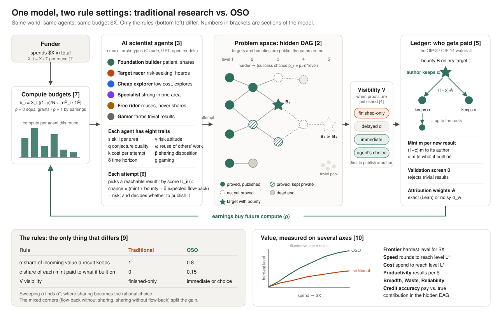

# OSO v1 demo: research-community model

**Author:** Gajendra Jung Katuwal (@himalayajung) · **Status:** Draft for discussion · **Last updated:** 2026-10-15 · **Simulator:** [open-science-org/app `sim/`](https://github.com/open-science-org/app/tree/master/sim)

> **TL;DR.** The v1 demo is an experiment.
> - **What it compares.** Two communities of AI scientist agents get the same budget and the same problem. One works under traditional incentives, the other under OSO incentives.
> - **What it tests.** Whether OSO produces more value: faster, cheaper, and harder results.
> - **How traditional research fits.** It isn't a separate system. It is OSO with flow-back switched off and only finished work shared.
>
> This doc gives the model behind the experiment, so the parameters can be explored by simulation before money is spent on LLM agents. The problem space is still open; formal math in Lean is the leading candidate.



## Question

For the same budget, does a community of AI scientist agents working under OSO incentives produce more verified value than the same agents under traditional incentives?

**Hypothesis.** Paying credit back to the work a result builds on makes building and sharing reusable foundations worthwhile, instead of racing for final results and hiding work until it is finished. Over time this compounds into reaching harder results for the same money.

**Why it matters now.** AI agents doing research will flood the literature, and they cost money. Whoever funds them wants the most research value per dollar. If the incentive rules decide how much an agent community achieves, OSO's rules are worth testing directly.

## Design

### Traditional research as a special case of OSO

Two axes of the rules separate traditional research from OSO:

1. **Flow-back.** Does value flow back to the work a result built on? OSO controls this with α, the share of incoming value a result keeps (OIP-14), and c, the share of each new result's mint paid to what it built on (OIP-8).
2. **Visibility.** When does work become visible to others: only when finished, after a delay, immediately, or when its author chooses?

| | Flow-back off (α = 1, c = 0) | Flow-back on |
| --- | --- | --- |
| **Finished only** | **Traditional research** (baseline) | Credit without sharing |
| **Immediate** | Sharing without credit (Polymath-style) | **Full OSO** |

The world, the agents and the budget are identical in every setting; only the rules change. Everything runs through one implementation, so a difference between settings can only come from the rules.

### The mechanism test

OSO's claim is not that forced sharing helps. Its claim is that flow-back makes sharing the rational choice. So a third visibility setting, **agent's choice**, lets each agent decide whether to publish a result now or keep it private.
- **Without flow-back:** publishing a lemma early only helps rivals win the bounty first, so agents should hoard.
- **With flow-back:** publishing earns flow-back when others build on it, so agents should share.

If agents share more when flow-back is on, and the sharing leads to harder results, that is evidence for the mechanism, not only for its effects.

### Comparisons

| Comparison | Answers |
| --- | --- |
| Traditional vs. OSO | The headline: how much more value OSO produces |
| The two mixed corners | How much of the gain comes from sharing, from credit, and from both together |
| Agent's choice, flow-back off vs. on | Whether flow-back causes sharing |
| A sweep of α (and c) | The threshold α\* where sharing becomes rational, and the best setting |

## The model

Section numbers match the figure.

### 1. Time and money

- **Rounds:** t = 1, …, T.
- **Budget:** a funder spends a total of **X** compute units, released as **X_t = X / T** per round.
- **Cost:** one attempt by agent i costs **k_i** units.

### 2. The world: a hidden DAG of results

R is the set of results and E the edges between them. Each result r has:

- **prerequisites** P(r) ⊂ R: r can be attempted only when all of them are known;
- **level** ℓ(r): the longest path to r from a root. This is its difficulty level;
- **difficulty:** a base success chance per attempt, **p_r = p₀ · η^ℓ(r)**, with 0 < η < 1;
- **area** a(r) ∈ {1…K}: its subfield.

The world also contains:

- **Targets** T ⊂ R, with public bounties **B_t = B₀ · g^ℓ(t)**. The paths to them are hidden.
- **Dead ends:** results with no target among their descendants. They can be proved but lead nowhere.
- **A trivial pool:** results that are always provable and have no descendants and no value. This is what spam produces.
- **Attribution weights** w(r, j) for each j ∈ P(r), summing to 1 over j.
  - The true weights are cost shares: w(r, j) ∝ 1 / p_j.
  - The ledger uses estimated weights ŵ = w + noise with spread **σ_w**. σ_w = 0 means exact attribution, as in Lean; σ_w > 0 means estimated attribution, for example by embeddings.

**Shape parameters:** depth, branching, number of areas, dead-end fraction, p₀, η, B₀, g.

### 3. Agents

Agent i has eight core traits:

| Trait | Symbol | Effect |
| --- | --- | --- |
| Proving skill per area | s_i,a | Success chance per attempt: π_i(r) = min(1, s_i,a(r) · p_r) |
| Conjecture quality | q_i | How noisy the agent's sense of which results matter is (section 5) |
| Cost per attempt | k_i | Attempts per round = b_i(t) / k_i |
| Time horizon | δ_i | Discount per round on future rewards |
| Risk attitude | γ_i | Penalty on uncertain payoffs |
| Reuse | ω_i | Chance per round that the agent takes up another agent's published result. Low reuse means a lag before the agent can build on others' work, during which it may prove the result again |
| Sharing disposition | β_i | Intrinsic value the agent places on publishing |
| Gaming | g_i | Share of attempts spent farming trivial results |

Two settings apply to the whole population: **τ**, rationality (softmax temperature), and **ε**, the exploration rate. Later versions may add specialization breadth, an exploration rate per agent, and attention: how much of the graph an agent reads before acting.

**Archetypes.** The population is a mix of named types, each a fixed set of trait values. The mix is varied between runs, with sensitivity checks on single traits.

| Archetype | Character |
| --- | --- |
| Foundation builder | Patient, shares, prefers safe lemmas |
| Target racer | Impatient, risk-seeking, hoards |
| Cheap explorer | Low cost and low skill, explores widely |
| Specialist | Strong in one area |
| Free rider | Reuses others' work, never shares |
| Gamer | Farms trivial results |

In the LLM experiment, some traits come from the choice of model (skill, conjecture quality, cost) and some from the prompt (horizon, risk, sharing). All of them are also measured from behaviour, to check the model against the agents.

### 4. Knowledge, priority and visibility

- **Known results.** K_i(t) is what agent i knows: its own proved results, plus published results it has taken up (each with chance ω_i per round).
- **Frontier.** F_i(t) = { r : P(r) ⊆ K_i(t), r not already proved by i } is what agent i can attempt.
- **Priority.** The **author of record** of r is the first agent to publish it. Any other proof of r is a **duplicate**: it earns nothing and counts as waste.
- **Visibility rule V:**
  - **finished-only:** a result stays private until its author proves a target that uses it; then the author's whole supporting bundle is published together;
  - **delayed(d):** a result is published d rounds after it is proved;
  - **immediate:** a result is published as soon as it is proved;
  - **agent's choice:** the agent decides by the rule in section 6. Anything still private is published with the first target that uses it.

Under every rule, a published result's prerequisites are published, so value never flows to hidden work.

### 5. Rewards

One ledger, following OIP-8 and OIP-14.

**The waterfall.** Value v entering result r is split:
- r's author keeps **α · v**;
- **(1 − α) · v** flows to r's prerequisites by weight ŵ, recursively;
- roots keep everything that reaches them.

The share of value entering r that reaches an ancestor j is:

```
share(r → j) = Σ over paths r→…→j of  [ Π along the path of (1 − α)·ŵ ] · α_j
               where α_j = α, or 1 if j is a root
```

**Mint.** Each newly published, non-trivial result mints m:
- its author gets (1 − c) · m;
- c · m enters its prerequisites through the waterfall.

**Bounty.** When a target t is first published, B_t enters t through the waterfall.

**Validation screen.** A trivial result is rejected with probability **θ**. This is OSO's admission check (OIP-11).

**Attribution value.** S_r is what authoring r can be expected to earn later from flow-back:

```
S_r = Σ over targets t below r of  B_t · Pr(t solved) · share(t → r)
      + c · m · (expected number of descendants of r)
```

Agents do not see the DAG, so agent i perceives S_r with noise that shrinks as its conjecture quality grows:

```
Ŝ_i(r) = S_r · (1 + σ₀ · (1 − q_i) · ξ),   ξ ~ N(0, 1)
```

With traditional rules (α = 1, c = 0), **S_r = 0 for every result that is not a target**: only targets pay beyond the base mint.

### 6. Decisions

**What to attempt.** For each attempt, agent i:
- farms a trivial result, with probability g_i;
- otherwise picks a random result in F_i(t), with probability ε;
- otherwise picks r from F_i(t) by softmax over the score U_i(r), with temperature τ.

The score is:

```
V_i(r) = (1 − c)·m  +  1[r ∈ T] · α · B_r · win_i(r)  +  δ_i^h(r) · α · B̂_down,i(r) · win_i(r)  +  δ_i^h(r) · Ŝ_i(r)
U_i(r) = V_i(r) · ( π_i(r) − γ_i · √(π_i(r)·(1 − π_i(r))) )
```

The four terms of V are the mint, the bounty if r is a target, r's value as a **stepping stone** to a target the agent may win itself (under any rules, a lemma is worth proving on the way to one's own target), and flow-back. Here:
- win_i(r) = 1 / (1 + rivals), where rivals is the number of other agents that can attempt r now;
- B̂_down,i(r) is the agent's noisy estimate of the largest bounty below r;
- h(r) is the expected delay until value from targets below r arrives.

**Whether to publish now** (agent's-choice visibility only). The agent publishes r now if:

```
β_i · m  +  mint at risk  +  δ_i · Ŝ_i(r) · κ  ≥  α · B̂_down,i(r) · win_i(r) · ψ
```

- **Left side:** the intrinsic value of sharing; the mint, which publishing earns now and keeping private earns only if the agent later wins a target that uses r (mint at risk = mint × (1 − δ^h · win)); and the flow-back gained because others can now build on r. κ is how much publishing raises r's expected use.
- **Right side:** the risk of being scooped. B̂_down,i(r) is the bounty the agent hopes to win on a target below r; ψ is how much publishing raises a rival's chance of winning it first.

**Prediction.** With traditional rules, Ŝ = 0 for lemmas, so an agent publishes a lemma only if its sharing disposition β_i is large: rational agents hoard. As α falls, the left side grows and the right side shrinks. They cross at a threshold **α\***, below which sharing is the rational choice.

### 7. The compute loop

Earnings buy future compute, while total spend stays fixed at X:

```
b_i(t) = X_t · [ (1 − ρ)/N  +  ρ · Ē_i(t) / Σ_j Ē_j(t) ]
Ē_i(t) = λ_E · Ē_i(t−1) + (1 − λ_E) · earnings_i(t)        (smoothed recent earnings)
```

- **ρ = 0:** equal fixed grants.
- **ρ = 1:** compute allocated by earnings alone.

This loop is how incentives change what an LLM agent can do: an agent cannot respond to rewards it cannot spend.

### 8. One round

1. Allocate budgets b_i(t) (section 7).
2. Agents choose and make their attempts (section 6). Each succeeds with probability π_i(r).
3. Successes pass the validation screen θ and are recorded with their priority.
4. Publication follows the visibility rule V.
5. Mints and bounties are paid through the waterfall (section 5).
6. Every agent's known results K_i are updated.

The run stops when X is spent, or earlier when every target is solved: a funder stops paying then. Each setting is run S times with different random seeds.

### 9. Settings

| Rule | Traditional | OSO |
| --- | --- | --- |
| α: share of incoming value a result keeps | **1** | 0.8 |
| c: share of each mint paid to what it built on | **0** | 0.15 |
| V: visibility | **finished-only** | immediate, or agent's choice (the mechanism test) |
| θ, m, B_t, ρ, σ_w | same | same |

The values for OSO are starting points. The α and c sweeps decide them.

### 10. Measures

Value is measured on several axes, because a setting can be fastest but expensive, or cheap but never reach anything hard. Two framings are both needed: what you get for a fixed budget, and what a fixed target costs.

| Axis | Definition |
| --- | --- |
| **Frontier** | The highest level ℓ(r) published by spend x, as a curve over x ∈ [0, X]. This is the headline figure |
| **Speed** | The first round in which a result of level L\* is published |
| **Cost** | Cumulative spend at that round |
| **Productivity** | Distinct published, non-trivial results per unit of spend |
| **Breadth** | Share of targets solved; number of areas reached |
| **Waste** | Share of spend on redundant work (attempts on results someone else published first), dead ends and trivial results |
| **Reliability** | Share of runs that reach L\*, and the spread across runs |
| **Credit accuracy** | 1 − ½ Σ_i \| bounty pay share_i − contribution share_i \|. **Contribution** comes from the hidden DAG: each solved target's bounty is split over every result in its proof in proportion to that result's cost 1/p_r. **Bounty pay share** is the agent's share of bounty payouts (the mint is per-result credit and is left out). When one agent proves a whole chain alone, as under traditional rules, this is trivially high, so compare it between settings that share work |

**Diagnostics** that explain the outcomes:
- sharing rate;
- time from proof to publication;
- reuse: how often a result is built on;
- duplication;
- earnings by archetype.

**Presentation:**
- the frontier-vs-spend curve, one line per setting;
- a profile of all eight axes for each setting;
- a Pareto view where settings trade one axis against another;
- the α sweep, with α\* marked.

## First simulation results

The simulator, its full description and every saved result are in the app repository: [sim/README.md](https://github.com/open-science-org/app/blob/master/sim/README.md), with results logged in [sim/results/](https://github.com/open-science-org/app/blob/master/sim/results/LOG.md). Each result names the commit that produced it and can be regenerated with one command.

**Simple model first.** On a single chain with N identical agents, sharing progress reaches about N times deeper than hiding it for the same budget. The simulator matches the exact prediction for every N from 1 to 16. This check also found a flaw in the first random-number generator, which was then replaced.

**Full model, default world** (8 levels, 7 targets, 12 agents, X = 1,200; 100 seeds; mean):

| Setting | Frontier (level) | Runs reaching level 7 | Cost to level 7 |
| --- | --- | --- | --- |
| Traditional | 5.7 | 35% | 957 |
| OSO (immediate) | 7.9 | 100% | 485 |
| No flow-back, immediate | 7.9 | 100% | 494 |
| OSO (agent's choice) | 6.3 | 43% | 959 |

What they show so far:

1. **Sharing does most of the work.** Immediate visibility reaches level 7 in every run at about half the cost, with or without flow-back. In this model the effect is largely built in, because published results are free to use and always correct.
2. **Flow-back makes agents choose to share only well below α = 0.8.** Under agent's-choice visibility, the share of lemmas shared is 0.23 at α = 1, 0.22 at 0.8, 0.47 at 0.3 and 0.77 at 0.1. With a lower scoop risk (ψ = 0.1), it is already 0.61 at α = 0.5. So α\* exists in the model, but its value depends on ψ, which is a guess.
3. **The cited mint share c barely matters,** because the mint is small next to the bounties.
4. **Flow-back makes credit more accurate when work is shared:** 0.57 vs. 0.47.
5. **Under traditional rules, a single gaming agent captures most of the compute and a median of all the pay.** Nobody else earns until they win a target, so the earnings-driven compute loop funds the spammer. Without the gamer, traditional reaches level 7.0 and the gap to OSO shrinks from 2.2 levels to 1.0. A large part of the default gap therefore comes from this combination, and should be presented with that decomposition.

These are a first calibration, not a result to present. The simulator's limits are listed in [sim/README.md, section 6](https://github.com/open-science-org/app/blob/master/sim/README.md#6-what-this-simulation-can-and-cannot-show).

## Simplifications to revisit

- Agents see noisy attribution values, not the DAG itself.
- Each attempt is a single success-or-failure draw.
- True attribution weights are cost shares.
- The scoop risk ψ and the publication boost κ are fixed numbers, not derived.

Each is a place where the LLM experiment may behave differently from the model, and each should be checked against measured agent behaviour.

## Predictions to test

1. **Sharing pools search.** On a chain of L results with N agents:
   - without sharing, each agent proves every step itself, and the deepest level reached for spend X is about X·p / N;
   - with sharing, the first proof of each step unlocks it for everyone, and the deepest level is about X·p.

   That is about N times deeper for the same budget. Branching DAGs should gain more, because work can also run in parallel.
2. **Flow-back makes sharing rational.** Under agent's-choice visibility, agents hoard above α\* and share below it.
3. **Limits.** OSO's advantage should shrink when agents are impatient (low δ), and should break when gamers are common and the validation screen θ is weak. Both are limits to state honestly.
4. **Credit.** Traditional rules pay final provers and leave foundation builders unpaid; OSO's pay should track true contribution.

These are model predictions, not results. The simulation tests them, and the LLM experiment tests whether real agents behave like the model.

## Problem space

Any problem space must:
- **be compositional:** hard results need intermediate results;
- **be verifiable:** a machine checks each result cheaply and without argument;
- **have graded difficulty:** levels 1–5;
- **leave the steps open:** intermediate results are not given, and agents must find them;
- **be safe from memorization:** solutions must not already be in the models' training data.

| Candidate | Strengths | Weaknesses |
| --- | --- | --- |
| **Formal math in Lean (leading)** | Proofs are checked by machine; attribution is exact, because a proof records the lemmas it uses; lemmas proposed by agents become ideas in the graph | Needs a target set with fresh intermediate lemmas, and Lean tooling for the agents |
| Synthetic compositional puzzles | Cheapest; fully controlled; ground truth known exactly | Less convincing to outsiders |
| Program synthesis with test suites | Machine-checked; familiar | Attribution between programs is less exact |
| Symbolic physics derivations | Matches the original theoretical-physics idea | Harder to verify automatically |

## Validity

- Several runs per setting, reported with their spread, not one best run.
- The same models and prompts in every setting, except the sentence describing the reward rule.
- Primary and secondary measures fixed before the first run.
- A check that target solutions are not memorized.
- Exact accounting of tokens and dollars per agent.
- Ablations: no compute loop (ρ = 0), noisy attribution (σ_w > 0), and different archetype mixes.
- **What would count against OSO:** flow-back adds nothing beyond visibility, or OSO's lead comes only from trivial results.

## Phases

1. **Simulation.** Implement this model, reusing the ledger's tested OIP-14 waterfall from [open-science-org/app](https://github.com/open-science-org/app). Run thousands of settings without LLMs; find α\* and the settings worth testing.
2. **Pilot.** LLM agents on a small problem set with cheap models, in the traditional and OSO settings. Check the mechanics and whether incentives move behaviour at all.
3. **Full runs.** The chosen problem space, the real budget, several runs per setting.
4. **Demo.** The settings' DAGs growing side by side, the frontier-vs-spend curves and the α sweep. All runs replayable from their logs.

## Open decisions

- [ ] Problem space: Lean or another candidate.
- [ ] Audience and deadline for the demo.
- [ ] Budget X per setting, and the number of runs.
- [ ] Models for the agents.
- [ ] Bounty levels, and the target level L\* for the speed and cost measures.
- [ ] Who builds what (Abinash, Bikrant).
