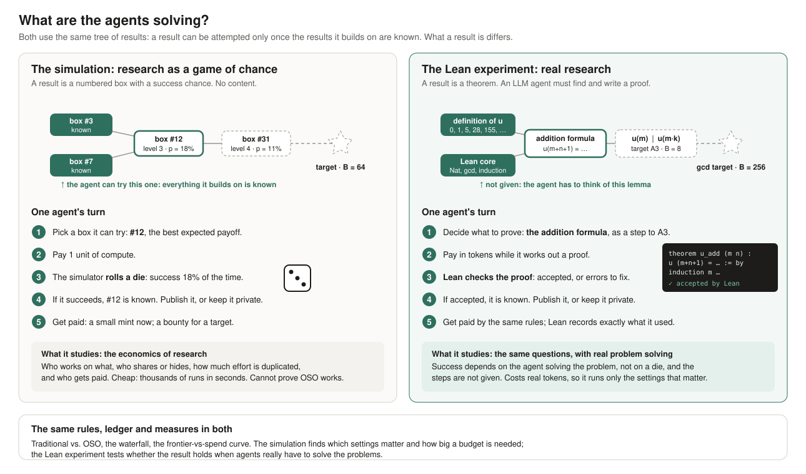

# OSO v1 demo: experiment specification

**Author:** Gajendra Jung Katuwal (@himalayajung) · **Status:** Draft for discussion · **Last updated:** 2026-10-19

**Implementations:**
- **Problem-space reports:** [index](https://github.com/open-science-org/experiment/blob/master/reports/README.md)
- **Simulator:** [open-science-org/experiment](https://github.com/open-science-org/experiment)
- **Lean problem set:** in preparation, in the experiment repository
- **Results:** [log of saved runs](https://github.com/open-science-org/experiment/blob/master/results/LOG.md)

> **TL;DR.**
> - **The experiment.** The v1 demo compares two communities of AI research agents, given the same budget and the same problems. One works under traditional incentives, the other under OSO incentives. The question is which produces more value: faster, cheaper, and harder results.
> - **This doc is the canonical specification.** It defines the research environment once, independent of any problem: results, attempts, success, sharing, rewards, rounds and measures.
> - **Two instantiations so far.**
>   - **The simulation:** results are abstract, and an attempt succeeds with a set chance. It is cheap and runs thousands of experiments.
>   - **The Lean experiment:** results are real theorems, and an attempt succeeds when Lean accepts the agent's proof.
> - **More complex experiments** are new instantiations of the same specification: new worlds, success oracles, agents or rules.
> - **Traditional research is not a separate system.** It is one setting of OSO's rules.
> - **Anyone can add a problem space,** by hand or by describing it in words, and get the same canonical report for it (section 8).

## 1. Question and approach

**Question.** For the same budget, does a community of AI research agents working under OSO incentives produce more verified value than the same agents under traditional incentives?

**Hypothesis.** Hiding unfinished work makes every agent repeat the steps others have already done. Paying credit back to the work a result builds on makes sharing worthwhile. Together these should let a community reach harder results for the same money.

**Why now.** AI agents doing research will flood the literature, and they cost money. Whoever funds them wants the most research value per dollar.

**Approach.**
1. **One environment, defined here.** Every experiment uses the same concepts and protocol, whatever its problems are.
2. **The incentive rules are parameters.** Traditional research and OSO are two settings of the same rules (section 3), so a difference between them can only come from the rules.
3. **Simulation first, then real problems.** The simulation explores thousands of settings cheaply, with no real problem content. The Lean experiment then tests the settings that matter, with real problems and LLM agents.

## 2. The environment

This section is canonical: both instantiations, and any future one, follow it. Where an element is decided by the instantiation, the text says so and section 6 says how.

### 2.1 Results and the research tree

| Term | Definition |
| --- | --- |
| **Result** | One unit of research output. In the simulation, an abstract node; in the Lean experiment, a theorem |
| **Prerequisite** | A result that another result builds on. A result can be attempted only by an agent that knows all its prerequisites |
| **Research tree** | All results and their prerequisite links: a directed acyclic graph (DAG) |
| **Root** | A result with no prerequisites |
| **Level** | 1 for a root; otherwise 1 + the highest level among the result's prerequisites. Higher levels are deeper, and usually harder |
| **Target** | A result with a public bounty. Targets are announced at the start |
| **Dead end** | A result that no target depends on. It can be proved, but leads nowhere |
| **Trivial result** | A result with no value that costs almost nothing to produce, such as spam |
| **Frontier of an agent** | The results the agent can attempt now: those it does not know whose prerequisites it all knows |

Agents see the targets, their bounties, and the results they know. They do not see the rest of the tree. In the simulation the whole tree exists in advance and is hidden. In the Lean experiment, intermediate results do not exist until an agent states them.

### 2.2 Attempts and success

| Term | Definition |
| --- | --- |
| **Attempt** | One try by one agent at one result on its frontier. It costs compute: the agent's cost per attempt |
| **Success** | The attempt worked: the agent has now proved the result and knows it. Nothing else counts as success |
| **Failure** | The attempt did not work. The compute is spent and nothing is gained, except what a learning oracle carries forward (below) |
| **Success oracle** | What decides whether an attempt succeeds. It is set by the instantiation (section 6) |
| **Success chance p** | The probability that an attempt succeeds. The simulation sets it from the result's level and the agent's skill; in the Lean experiment it is measured, not set |
| **Duplicate** | A success on a result someone else has already published. It earns nothing and counts as waste |

**One rule for success, two oracles:**
- **Simulation:** an attempt succeeds with chance p. The simulator draws a random number between 0 and 1, and the attempt succeeds if the number is below p.
- **Lean:** an attempt succeeds if Lean's checker accepts the proof the agent wrote.

**Learning from failure (optional).** With a learning oracle, each failed attempt raises the next chance on that result. The rule `publishFailures` makes failed attempts public, so other agents learn from them too.

### 2.3 Knowledge and sharing

| Term | Definition |
| --- | --- |
| **Knowledge of an agent** | The results it can build on: those it proved itself, plus published results it has taken up |
| **Publish** | Make a proved result public. Its prover becomes its **author of record**, if nobody published it first |
| **Visibility rule** | When a proved result is published (section 3): only together with a target that uses it, after a delay, at once, or when the agent decides |
| **Uptake** | Another agent adding a published result to its knowledge. Each agent takes up each published result with its reuse chance per round |
| **Private result** | Proved but not published. Other agents know nothing about it, not even that it exists, so they may prove it again |

**Publishing a result always publishes the private results it depends on,** so a published result never rests on hidden work.

**What an agent knows** (the information model):

| Information | Every agent knows | Only some agents know |
| --- | --- | --- |
| The targets and their bounties | ✓ | |
| The rules (α, c, visibility, mint, bounties) | ✓ | |
| Its own proved results, published or private | | ✓ (its own) |
| Published results | ✓, once taken up | |
| Another agent's private results | | nobody else |
| How many agents can attempt each result now (in the simulation, used to estimate the race) | ✓ | |
| The rest of the research tree, including dead ends | | nobody |

**What sharing conveys depends on the instantiation:**

| A published result tells other agents | Simulation | Lean experiment |
| --- | --- | --- |
| That the result is proved, so they may build on it | ✓ | ✓ |
| Its statement, so which intermediate results are worth having | — (results are abstract) | ✓ |
| How it was proved, so the method can be reused | — | ✓ (the proof is readable) |
| That it is correct | ✓ (always) | ✓ (checked by Lean) |
| Failed attempts | Only with the rule `publishFailures` (and a learning oracle) | Could be added as the same rule |

By default the simulation captures only one effect of sharing: **nobody has to prove a shared result again.** It omits the transfer of know-how, and assumes shared results are free to absorb and always correct.

**Costly and fallible knowledge (optional).** Two settings remove the last two assumptions:
- **Absorbing costs compute** (`absorbCost`): an agent pays it for each published result it takes up, from its compute for the round.
- **Proofs can be wrong** (`errorRate`), and anything built on a wrong result is wrong too:
  - targets are checked, so a target proof that rests on a wrong result is rejected;
  - the wrong results it rested on come to light and are retracted, and every agent that took them up loses them;
  - mints already paid stay, under OIP-11's rule of no clawback.

  In the Lean experiment proofs are never wrong, because Lean checks them; absorbing costs reading tokens.

### 2.4 Rewards

All payments use one ledger, with the rules of OIP-8 and OIP-14.

- **Mint.** Every newly published, non-trivial result mints m:
  - its author gets (1 − c) · m (all of m for a root);
  - c · m flows to the results it built on, through the waterfall.
- **Bounty.** When a target is first published, its bounty B enters it through the waterfall.
- **Waterfall.** Value entering a result is split:
  - its author keeps a share **α**;
  - the rest, 1 − α, flows to its prerequisites in proportion to their attribution weights, and the split repeats at each of them;
  - a root keeps everything that reaches it.
- **Attribution weights.** How much a result relied on each prerequisite. Exact where the instantiation shows it (in Lean, the proof records which results it uses); estimated otherwise.
- **Validation screen.** A trivial result is rejected with probability **θ** and then earns nothing. This is OSO's admission check (OIP-11).

### 2.5 Budget and compute

| Term | Definition |
| --- | --- |
| **Budget X** | Total compute the funder spends in a run |
| **Round** | One step of the run. Each round releases X / T compute, where T is the number of rounds |
| **Allocation** | How a round's compute is split among agents. The default is half equally, half in proportion to recent earnings (ρ = 0.5), so earnings buy future compute |
| **Stop** | A run ends when the budget is spent, or as soon as every target is solved |

### 2.6 One round

1. **Allocate** compute to agents (section 2.5).
2. **Attempt.** Each agent spends its compute on attempts, in an interleaved random order so that agents race. For each attempt:
   - the agent chooses a result on its frontier, or farms a trivial result;
   - the success oracle decides the outcome;
   - **on success:** the result is now known to the agent; a duplicate earns nothing; otherwise the visibility rule decides whether to publish it now.
3. **Publish and pay.** Each publication makes the agent the author of record and pays mints and bounties through the waterfall.
4. **Take up.** Agents take up newly published results.
5. **Record** the measures (section 5).

The figure shows one round as a loop. Numbers in brackets are sections of this specification.

### 2.7 Worked example: why sharing helps

**The setup:**
- **Results:** three in a row. **A**; then **B**, which needs A; then **C**, which needs B. C is the target.
- **Agents:** two, each with one attempt per round.
- **Success chance:** every attempt succeeds with chance p = 50%.

To compare fairly, both worlds use the same outcomes (✓ success, ✗ failure):

| Round | Agent 1 | Agent 2 |
| --- | --- | --- |
| 1 | ✓ | ✗ |
| 2 | ✗ | ✓ |
| 3 | ✓ | ✗ |
| 4 | ✗ | ✗ |
| 5 | ✓ | ✓ |

**Hidden (finished-only).** Each agent must prove A, B and C itself:

| Round | Agent 1 | Agent 2 |
| --- | --- | --- |
| 1 | proves A | — |
| 2 | — | proves A again |
| 3 | proves B | — |
| 4 | — | — |
| 5 | **proves C** | proves B again |

The target is reached in round 5, after 10 attempts. Agent 2's two successes were duplicates.

**Shared (immediate).** Each success is published, and both agents work on the next step:

| Round | Step | Agent 1 | Agent 2 | Outcome |
| --- | --- | --- | --- | --- |
| 1 | A | ✓ | ✗ | A proved |
| 2 | B | ✗ | ✓ | B proved |
| 3 | C | ✓ | ✗ | **C proved** |

The target is reached in round 3, after 6 attempts, and no success is wasted.

**In general:** hidden progress needs a success from every agent on every step; shared progress needs one success from anyone. With N agents, sharing reaches about N times deeper for the same budget. The simulator's simple model confirms this against the exact mathematics (section 9).

## 3. The rules

The rules are the only thing that differs between the settings compared. Two axes separate traditional research from OSO:

| Axis | Parameter | Traditional | OSO |
| --- | --- | --- | --- |
| **Flow-back:** does value reach the work a result built on? | α (share a result keeps) and c (share of each mint paid to what it built on) | α = 1, c = 0: nothing flows back | e.g. α = 0.8, c = 0.15 |
| **Visibility:** when is work published? | visibility rule | finished-only | immediate, or agent's choice |

| | Flow-back off | Flow-back on |
| --- | --- | --- |
| **Finished-only** | **Traditional research** | Credit without sharing |
| **Immediate** | Sharing without credit | **Full OSO** |

- **The main comparison** is traditional vs. full OSO.
- **The mixed corners** separate the gain from sharing from the gain from credit.
- **Publishing failed attempts** (`publishFailures`) is a further visibility option; it matters when agents learn from failure.
- **The mechanism test** uses agent's-choice visibility. OSO claims flow-back makes sharing the rational choice, so agents should share more when flow-back is on. A sweep of α finds the threshold α\* where they start to.

The mint m, the bounties, the screen θ and the compute allocation are held the same across the compared settings.

## 4. Agents

### 4.1 Traits

Every agent, simulated or LLM, is described by eight traits. In the simulation they are parameters; in the Lean experiment some are set by the choice of model or prompt, and all are measured from behaviour.

| Trait | Meaning |
| --- | --- |
| Skill | How likely its attempts are to succeed |
| Conjecture quality | How well it judges which results are worth attempting |
| Cost per attempt | Compute per attempt (model price, in the Lean experiment) |
| Time horizon | How much it values rewards that arrive later |
| Risk attitude | Preference for safe steps vs. long shots |
| Reuse | How readily it builds on others' published work |
| Sharing disposition | Intrinsic willingness to publish, beyond what pays |
| Gaming | Share of its effort spent on trivial results |

A population is a mix of **archetypes**, each a set of trait values: foundation builder, target racer, cheap explorer, specialist, free rider, gamer. The simulator's values are in [scenarios/default.yaml](https://github.com/open-science-org/experiment/blob/master/config/scenarios/default.yaml).

### 4.2 How agents decide

**Simulated agents** follow a formula ([the simulator doc, section 2.5](https://github.com/open-science-org/experiment/blob/master/docs/simulator.md#25-decisions)):
- they score each frontier result by its expected value under the rules: mint, bounty, value as a stepping stone to a target, and flow-back, adjusted for success chance, impatience and risk;
- they mostly pick the best, with some randomness;
- under agent's-choice visibility, they publish a lemma when what sharing earns outweighs the risk of being scooped.

The formula is an assumption, and the simulation's results depend on it.

**LLM agents** (the Lean experiment) decide for themselves. Each is told the rules, the targets, the bounties and what it knows, and chooses what to attempt and whether to publish. The prompts are the same in every setting except for the sentence describing the rules. Their decisions are observed, not assumed. This is the main reason for running the Lean experiment.

## 5. Measures

Value is measured on several axes, because a setting can be fast but expensive, or cheap but never reach anything hard. Both framings are needed: what a fixed budget achieves, and what a fixed target costs.

| Measure | Definition |
| --- | --- |
| **Frontier** | The highest level among published results, by spend. As a curve over spend, this is the headline figure |
| **Reach** | Share of runs in which a result of level L\* was published |
| **Speed** | The first round in which level L\* was published |
| **Cost** | Compute spent by that round |
| **Productivity** | Published, non-trivial results per unit of spend |
| **Breadth** | Share of targets solved |
| **Waste** | Share of spend on duplicates and redundant attempts, dead ends and trivial results |
| **Reliability** | Spread of the measures across runs |
| **Credit accuracy** | How closely bounty pay matches true contribution. Contribution comes from the tree: each solved target's bounty is split over every result in its proof, in proportion to the result's difficulty. High trivially when one agent proves a whole chain alone, so compare it between settings that share work |

**Diagnostics** explain the outcomes: sharing rate, hoarding, publication lag, reuse, duplicates, and pay by archetype.

## 6. Instantiations

| Element | Simulation | Lean experiment |
| --- | --- | --- |
| Results | Abstract nodes, all existing in advance | Lean theorems; intermediate ones stated by agents |
| Research tree | Generated (random layers, a chain), or read from a file, such as the Lean reference tree | Defined by what proofs use; a reference tree from our own proofs |
| Targets and bounties | Configured | Posted theorems; bounty from measured depth |
| Success oracle | Chance p, from the level and the agent's skill; optionally learning from own and public failures | Lean's checker |
| Success chance p | Set (0.5 × 0.6^(level − 1) by default) | Measured in the pilot |
| What sharing conveys | That the result is proved | The statement and the proof |
| Cost and correctness of shared results | Free and correct by default; optionally a cost to absorb, and wrong results that are retracted | Reading costs tokens; Lean guarantees correctness |
| Attribution weights | By difficulty (exact or with noise) | Exact: the theorems a proof uses |
| Trivial results | Farmed by gaming agents; screen θ | Statements closed by one cheap tactic; rejected by the screen |
| Agents | Formula agents with set traits | LLM agents; traits from model and prompt, measured |
| Cost | Compute units | Tokens and checking time |
| Status | Built; results logged | Problem set built and verified; harness not built |

### 6.1 The simulation

[The simulator](https://github.com/open-science-org/experiment) implements sections 2 to 5, with simulated agents and the chance oracle. Every setting is configuration: [scenarios/default.yaml](https://github.com/open-science-org/experiment/blob/master/config/scenarios/default.yaml) documents the defaults, and experiments are YAML files. Its documentation, [docs/simulator.md](https://github.com/open-science-org/experiment/blob/master/docs/simulator.md), maps each element of this specification to its configuration and code.

**What it can show:**
- whether the mechanics work as specified;
- which parameters matter;
- failure modes;
- which settings, budgets and numbers of runs the Lean experiment needs.

**What it cannot show:** that OSO works with real research. Results are given rather than invented, sharing conveys no know-how, and agents follow a formula. Learning from failure, the cost of absorbing results and wrong results are optional mechanics, with guessed parameters.

### 6.2 The Lean experiment

The problem set has three areas, in Lean 4 with no Mathlib:
- **A:** a new number sequence;
- **B:** sorting;
- **C:** 2 × 2 integer matrices.

There are eight posted targets, including two that cross areas, and hidden reference proofs that Lean has checked. Agents propose statements and proofs, Lean checks them, and the same rules, ledger and measures apply. Success chances are measured in a pilot and can be fed back into the simulation as a world read from a file, with the reference tree and the measured chance per result.

## 7. Defining an experiment

An experiment is one instantiation plus a configuration:
- a **world:** the research tree, targets and bounties;
- a **success oracle;**
- **agents:** the population and how they decide;
- **rules:** α, c, mint, screen, visibility;
- a **budget** and allocation;
- the **measures**;
- the **factors** to vary, with the number of runs.

Each element is replaceable without changing the others:

| Extension point | Built today | Examples of more complex experiments |
| --- | --- | --- |
| World | Random layers, chain, DAG from a file, the Lean reference tree | The Lean reference tree with measured p; a real field's citation graph |
| Knowledge | Free and correct; costly to absorb; fallible, with retraction | Partial results; reviews that catch errors before a target does |
| Success oracle | Chance p; learning from own and public failures | Lean checker |
| Agents (deciders) | Formula agents; a random baseline; different deciders per archetype | LLM agents; mixed populations of formula and LLM agents |
| Visibility | Finished-only, delayed, immediate, agent's choice | Batched publication; sharing failed attempts |
| Allocation | Earnings share, equal | Grant committees; funding by reviewed quality |
| Rules | α, c, mint, screen | Different rules per area (OIP-12 community setups) |
| Measures | Section 5 | New columns or analyses |

In the simulator, every element is a plugin: world, success oracle, deciders, visibility, allocation, choice policy, measures and analyses. Experiments are YAML files ([the simulator doc, section 3](https://github.com/open-science-org/experiment/blob/master/docs/simulator.md#3-configuration-and-extending)). For the Lean experiment, an LLM decider and a Lean-checker oracle become two more plugins, once the core loop is made asynchronous.

## 8. Problem spaces and canonical reports

The framework is meant to be used beyond the cases built so far. Anyone can describe a new field and get a report on it that answers the same questions, in the same form, as every other field.

**A problem space** is one file ([spaces/](https://github.com/open-science-org/experiment/blob/master/spaces/)). It holds:
- a title, a one-sentence summary and a plain-language description of the field;
- a **glossary** of what a result, a target, an attempt, an area and an agent mean in that field;
- the area names;
- the scenario: the research tree, success chances, targets, agents and anything else that differs from the defaults.

**Adding one:**
- **By hand:** copy an example space and edit it. `npm run sim -- check <space>` validates it and test-runs it.
- **By description:** `npm run sim -- new "<a description of the field>"`.
  - Claude (claude-opus-5-5) writes the space file from the description, the documented settings and two example spaces. This needs an Anthropic API key (`ANTHROPIC_API_KEY`).
  - The file is checked against the scenario rules and test-run once; any error is sent back to the model to fix, up to three times.
  - The budget is then **calibrated**: it is set to the smallest budget at which the OSO community solves 90% of the targets on average. Every space is then hard but not hopeless, and the comparison is what the same money buys traditional research.

**The canonical report** (`npm run sim -- report <space>`) runs the same standard experiments on every space ([battery.ts](https://github.com/open-science-org/experiment/blob/master/src/report/battery.ts)) and always has the same sections:

| Section | What it answers |
| --- | --- |
| Headline | A verdict (OSO ahead, no clear difference, or traditional ahead, judged against two standard errors), plus: how far each community got, targets solved, cost to reach the main level, whether flow-back makes agents share (the threshold α\*), and the condition under which OSO's lead is smallest |
| 1. The problem space | The description, the glossary, a drawing of the research tree, its targets and difficulty by level |
| 2. Progress for the money | The frontier-vs-spend chart: traditional, OSO with immediate sharing, and OSO with agent's choice |
| 3. The six settings | Section 3's settings, with the standard measures |
| 4. Does flow-back make agents share? | Sharing and reach as α falls, with α\* |
| 5. When sharing is costly or sometimes wrong | The lead under free, costly, fallible, and costly-and-fallible knowledge |
| 6. Sensitivity to the parameters | OSO's lead as each parameter is varied alone. Two groups: those communities, funders or the protocol set (α, c, mint per result, validation screen θ, how far compute follows earnings ρ), and those we guessed about agents (ψ, κ, perception noise, choice randomness, attribution error). Also α × c together. Because communities will set these values, the result must hold across them. |
| What this shows | The limits, plus the space's own notes |
| Reproduce | The command, the space file, the data, and the simulator commit |

Reports are written in the field's own words, with charts that work in light and dark mode. An index ([reports/](https://github.com/open-science-org/experiment/blob/master/reports/)) lists every space with its verdict and headline numbers.

## 9. Results so far

All from the simulation; every run is [logged](https://github.com/open-science-org/experiment/blob/master/results/LOG.md) with the commit that produced it.

| Experiment | What it tests | Results |
| --- | --- | --- |
| Simple model | One chain, shared vs. hidden progress, against exact predictions | [summary](https://github.com/open-science-org/experiment/blob/master/results/simple/summary.md) |
| Six settings | Traditional, OSO and the mixed corners | [summary](https://github.com/open-science-org/experiment/blob/master/results/settings/summary.md) |
| α sweep | Sharing and outcomes as α falls, under agent's choice | [summary](https://github.com/open-science-org/experiment/blob/master/results/alpha-sweep/summary.md) |
| α × ψ × c | Where sharing becomes rational | [summary](https://github.com/open-science-org/experiment/blob/master/results/alpha-psi/summary.md) |
| Sensitivity | How much the gap depends on the gaming agent and the compute loop | [summary](https://github.com/open-science-org/experiment/blob/master/results/sensitivity/summary.md) |
| Lean tree | The six settings on the Lean problem set's reference tree | [summary](https://github.com/open-science-org/experiment/blob/master/results/lean-tree/summary.md) |
| Failures | Learning from own failures vs. from public failures | [summary](https://github.com/open-science-org/experiment/blob/master/results/failures/summary.md) |
| Costly sharing | Absorbing cost × error rate, traditional vs. OSO | [summary](https://github.com/open-science-org/experiment/blob/master/results/costly-sharing/summary.md) |
| Complex | All of the above together, on the Lean tree | [summary](https://github.com/open-science-org/experiment/blob/master/results/complex/summary.md) |

On the default world (8 levels, 7 targets, 12 agents, X = 1,200; 100 runs each):

| Setting | Frontier (level) | Runs reaching level 7 | Cost to level 7 |
| --- | --- | --- | --- |
| Traditional | 5.7 | 35% | 957 |
| OSO (immediate) | 7.9 | 100% | 485 |
| Sharing without flow-back | 7.9 | 100% | 494 |
| OSO (agent's choice) | 6.3 | 43% | 959 |

What they show so far:

1. **The simple model matches the mathematics.** With N agents on one chain, shared progress reaches about N times deeper than hidden progress, for N from 1 to 16.
2. **Sharing does most of the work.** In the simulation, this is largely built in, because shared results are free to absorb (section 2.3).
3. **Flow-back makes agents choose to share only well below α = 0.8.** The share of lemmas shared is:
   - 0.23 at α = 1;
   - 0.22 at 0.8;
   - 0.47 at 0.3;
   - 0.77 at 0.1.

   With a lower scoop risk (ψ = 0.1), it is already 0.61 at α = 0.5. So α\* exists in the model, but it depends on ψ, which is a guess.
4. **The cited mint share c barely matters,** because the mint is small next to the bounties.
5. **Flow-back makes credit more accurate when work is shared:** 0.57 vs. 0.47.
6. **About half the default gap comes from one gaming agent and the compute loop.** Under traditional rules nobody else earns until they win a target, so earnings-driven funding goes to the spammer. Without it, traditional reaches 7.0 and the gap shrinks from 2.2 levels to 1.0.

7. **On the real shape of the Lean problem set,** OSO solves all 8 targets in every run, at 125 compute to depth 5. Traditional solves 4.8 of 8, at 303. Agents also share more by choice there (0.42 at α = 0.8), because the tree has many shallow results that carry little scoop risk.
8. **Learning from public failures helps OSO most.** Cost to reach level 7 is 485 with no learning, 367 learning from own failures, and 284 learning from everyone's public failures. Traditional benefits less (957, 865, 810), because its agents climb apart.
9. **When sharing costs compute and results can be wrong, OSO's lead narrows but holds on depth.** At absorbing cost 1 and a 15% error rate, OSO still reaches level 6.6 against 4.5, but its lead in targets solved shrinks from 2.7 to 0.4. Errors hurt OSO more in absolute terms (21 retractions against 10), because wrong results spread to more agents.
10. **With everything combined on the Lean tree,** OSO stays ahead, but publishing failures adds nothing once absorbing is costly.

These are a first calibration of a model, not evidence about real research.

## 10. Validity

- **Several runs per setting,** reported with their spread. Settings are compared on the same seeds, so on the same worlds and agents.
- **The same agents, prompts, budget and world in every setting,** except for the rules.
- **Measures fixed before the runs.**
- **For LLM agents:**
  - check that targets are not memorized;
  - check that deep targets need intermediate results;
  - account exactly for tokens.
- **What would count against OSO:** flow-back adds nothing beyond visibility, or OSO's lead comes only from trivial results.

## 11. Phases and open decisions

**Phases:**
1. **Simulation** — done, first calibration.
2. **Lean problem set** — built and verified.
3. **Lean pilot:**
   - LLM agents on the problem set, in the traditional and OSO settings, with cheap models;
   - measure success chances, and check that incentives move behaviour at all.
4. **Full runs:** the real budget, several runs per setting.
5. **Demo:** the settings' trees growing side by side, the frontier-vs-spend curves and the α sweep, all replayable from logs.

**Open decisions:**
- [ ] Audience and deadline for the demo.
- [ ] Budget per setting, and the number of runs.
- [ ] Models for the agents.
- [ ] Where the Lean reference proofs are kept (private recommended), and whether agents may use `grind`.
- [ ] Who builds what (Abinash, Bikrant).
