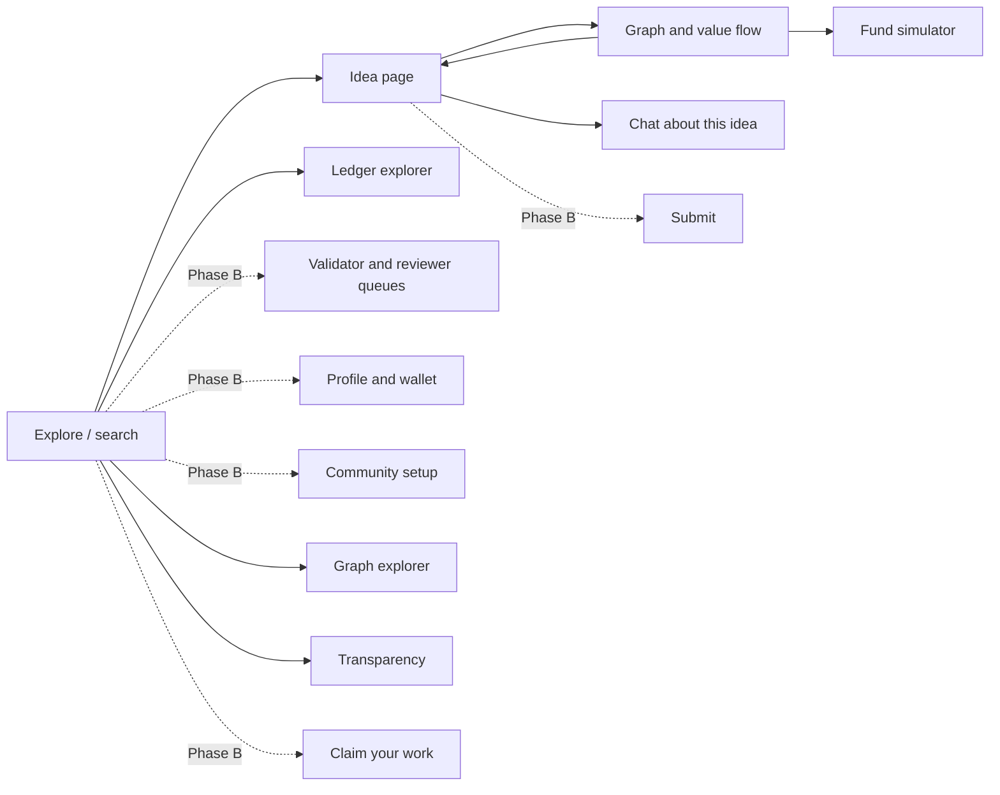
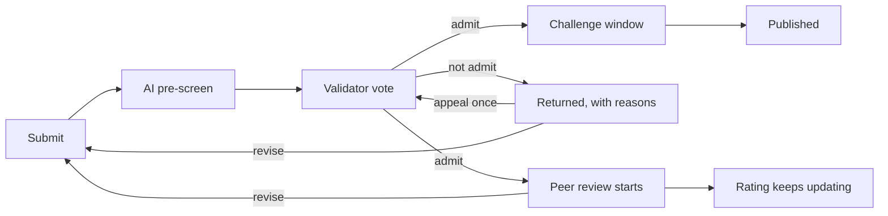

# The v1 app: screens and flows

Part of the [OSO website and v1 UI design](../ui-v1.md).

## Screens

| Screen | Phase A (now, mock data) | Phase B (with ledger) |
| --- | --- | --- |
| **Explore / search** | Search by title, author or keyword; browse the curated slice; filter by type and year | Filter by status and rating |
| **Idea page** | Title, authors, abstract, links (DOI, arXiv, PDF), type, license; parents and children lists with weights; "claimed / unclaimed" label for imported works | Owners, status timeline, reviews and rating, challenge info |
| **Graph and value flow** | Interactive graph of an idea's ancestors and descendants (two or three levels), edge thickness by weight; side panel with an edge's evidence (citation, AI score, rubric category) | Actual balances and flows from the ledger |
| **Fund simulator** | "Fund this idea with X OSO": animate the split down the graph using the API's result; table of who receives what | Real funding transactions |
| **Chat** | Chat grounded in the idea's abstract and its graph neighbours, with sources cited; clearly labelled AI; feature flag | Same, with per-user limits after sign-in |
| **Ledger explorer** | Blocks and transactions of the mock ledger, to show the idea of a public log | The real log on GitHub, with replay status |
| **Graph explorer** | Whole-field views: lineage over time, neighbourhood, field map, value flow, path finder, list; filters and export ([Graph explorer](#graph-explorer)) | Same, with live data |
| **Transparency** | Ledger status, OSO fund, bootstrap pool, AI spending, who decides ([Profile, notifications, transparency and admin](#profile-notifications-transparency-and-admin)) | Same, from the real ledger |
| Submit | Designed, not built | See [Workflow screens (Phase B): submit, validate, review](#workflow-screens-phase-b-submit-validate-review) |
| My work (submission status) | Designed, not built | See [Workflow screens (Phase B): submit, validate, review](#workflow-screens-phase-b-submit-validate-review) |
| Validator queue | Designed, not built | See [Workflow screens (Phase B): submit, validate, review](#workflow-screens-phase-b-submit-validate-review) |
| Reviewer inbox and review form | Designed, not built | See [Workflow screens (Phase B): submit, validate, review](#workflow-screens-phase-b-submit-validate-review) |
| Community setup | Designed, not built | See [Modular and customizable design](modularity.md) |
| Claim your work | Designed, not built | See [Claim your work](#claim-your-work) |
| Profile, notifications and integrations | Designed, not built | See [Profile, notifications, transparency and admin](#profile-notifications-transparency-and-admin) |
| Sign-in and linked accounts | Designed, not built | See [Sign-in and linked accounts](#sign-in-and-linked-accounts) |

## Key interactions

1. **Search, then idea page, then graph.** The core loop: find a paper, see what it built on and what built on it.
2. **Why this weight?** Clicking an edge shows where its weight came from: the citation, the AI's dependence score and category, the exact passages the AI relied on ([Data storage](storage.md)), and whether a person approved it. This makes OSO's attribution idea visible.
3. **Fund simulator.** Enter an amount, watch value flow up the graph level by level, then see a table of recipients. Every number comes from the API.
4. **Chat.** Ask "What does this paper build on?" or "What came after it?"; answers cite ideas in the graph with links and, where the text is available, the exact passage they rely on.

## Workflow screens (Phase B): submit, validate, review

These follow OIP-11 (submission routing) and OIP-17 (peer review). Every step, number and rule shown comes from the community's setup ([Modular and customizable design](modularity.md)), so another community can show different steps without a new screen.

| Screen | Who | What it shows and does |
| --- | --- | --- |
| **Submit** | Author | Five steps: (1) content: type, main file or link, the file's fingerprint (hash) computed in the browser, optional code or data; (2) details: title, abstract, license, AI use; (3) builds on: AI-suggested parents and weights, which the author adjusts to a 100% total, with any uncited dependency the AI found shown for the author to add or explain; (4) owners and shares, with each co-owner's signature status; (5) stake and sign. A side panel explains what happens next in this community. |
| **My work** (status) | Author | A timeline for each submission: submitted, pre-screen (with the report), validation (votes and reasons, public once the vote closes), challenge window (time left, any challenges), published, and peer review (invited reviewers, submitted reviews, current rating). Shows what is held in escrow, and actions: submit a new version, or appeal if returned. |
| **Validator queue** | Drawn validators | Assigned ideas with deadlines; the AI pre-screen report (spam likelihood, closest ideas, domain fit, proposed versus suggested weights, uncited dependencies); a checklist of the admission criteria; admit or not admit, optional spam mark, and a reason; a reminder that admission is not a quality verdict and that pay does not depend on the vote. Challenges and appeals assigned to the user appear in the same queue. |
| **Reviewer inbox and review form** | Assigned reviewers, expert readers and community members | Review happens in four layers (OIP-17): the spam filter (the validator queue above), **assigned expert review** (invitations to accept or decline before a deadline, paid), **expert reader review** (any expert who reads the idea, at any time) and **community review** (any signed-in member interested in the idea). Expert reviews use the full form: the four required questions, an optional AI-drafted start, a score from 0 to 10 with anchors, a recommendation (endorse, revise, concerns) and AI disclosure. Community reviews need only a comment, with an optional score. The idea page shows two ratings side by side: an expert rating and, once enough scores exist, a community rating. Users can rate other reviews for usefulness. |

**Submitting for peer review** needs no separate action: under OIP-17, assigned reviewers are invited automatically when an idea is admitted, and expert readers and community members can review it at any time after. If bounties for extra reviews are added (an open question in OIP-17), they get a button on the My work screen.

## Design principles

- **Plain language first.** Say "builds on" before "parent edge"; show terms like α and IDEA tokens with a short explanation on hover.
- **Honest labels.** Mark simulated tokens as simulated, AI output as AI, imported authors as unclaimed.
- **Accessible:** keyboard navigation, readable contrast in light and dark mode, and a list view of every graph for screen readers and small screens.
- **Fast on a laptop:** the curated slice (50 to 100 works) and two or three graph levels must render smoothly; the read-only import (thousands of works) only through search.

## Graph explorer

The neighbourhood view (screen 3) shows one idea; the graph explorer shows the whole curated slice. All views share one set of filters (link types, minimum weight, years, tier, highlight) and export options (image, JSON, GraphML for network-analysis tools, and an embeddable view).

| View | What it shows | Why it matters | Suggested library |
| --- | --- | --- | --- |
| **Lineage** | Ideas laid out left to right by year, edges showing what built on what, one idea's lineage highlighted | Matches the rule that credit flows back in time; the most intuitive view | Cytoscape.js with a layered layout (dagre or ELK) |
| **Neighbourhood** | One idea with parents and children, edge evidence and the fund simulator (screen 3) | Explains a single idea | Cytoscape.js |
| **Field map** | Every work as a point, placed by content similarity and grouped into topics | Shows the field's shape, crowded areas and gaps | Sigma.js with graphology (WebGL, thousands of points) |
| **Value flow** | Where a payment ends up after several hops, as a flow diagram | Makes flow-back visible to funders | D3 (Sankey) |
| **Path finder** | The shortest chain of "builds on" links between two ideas | Discovery and checking attribution | Any; computed by the API |
| **List** | The same data as a sortable table | Accessibility, small screens, quick scanning | Plain HTML |

The API computes layouts' inputs (graph, positions for the field map from embeddings, paths); the browser only draws them.

## Claim your work

The hook for existing researchers (design doc, "Imported literature"). Once a user links their ORCID account (from the profile, or prompted after first sign-in), the app lists imported works whose author record matches the user's ORCID iD, each with what has built on it and the value waiting for its authors. The user selects works and signs a claim. Matches by ORCID are approved automatically after a public notice period; matches by name only go to the claims panel with evidence; co-author shares are proposed by authors and decided by the panel, never assumed equal (OIP-10 section 6). A "not my work" link reports a wrong match. Side links help find more work: BibTeX or Zotero import, the browser extension, and GitHub or Hugging Face links ([Integrations and plugins](integrations.md)).

## Profile, notifications, transparency and admin

- **Profile:** sign-in methods (Google, email and others; add or remove), identity checks (ORCID, institutional email, vouches) with the user choosing which are public, and what each check unlocks; reputation per domain and eligibility to validate or review; simulated balances; owned ideas, claims and reviews; key custody and export.
- **Notifications:** validator draws, review invitations, deadlines and changes to one's own ideas, by email, in the app and optionally Slack or Discord. Without them the validator and reviewer queues stall, so they are required for Phase B.
- **Transparency page (public, no sign-in):** ledger status and independent replays, the OSO fund's balance and flows, the bootstrap pool, AI spending by task, provider and model (OIP-15 requires publishing it), and who currently decides, with links to the decision log and setup histories.
- **Operator console (internal):** AI budgets and spending caps, the import pipeline, moderation reports, and applying approved community-setup changes.
- **Later: frontiers view.** Open questions and gaps that AI finds in the graph, for the north star of opening new research frontiers.

## Sign-in and linked accounts

People sign in with an account they already have and add more later (OIP-10 sections 1 and 1a).

- **At launch:** Google and a one-time link by email; GitHub and ORCID as further options. No password of our own to store.
- **Future work: Sign in with Apple.** It requires a paid Apple Developer Program membership, so it waits until there is a budget and an owner for that account. Adding it later is a configuration change.
- **Linking:** from the profile, a user links more sign-in methods and attestations (ORCID, institutional email). A new method is linked only while signed in, so two accounts never create two identities by accident; signing in with an unlinked account creates a new identity, and the app offers to merge only after the user proves control of both.
- **What each step unlocks**, shown plainly in the app: any sign-in lets you submit and review openly; linking ORCID lets you claim your papers; earned reputation (plus whatever the community requires) makes you eligible to validate and to be invited as a reviewer.
- **Prompts, not walls:** after first sign-in, a short "link ORCID to find your papers" prompt; it can be skipped.
- **Privacy:** emails and account identifiers stay with the operator and never go on the ledger; the user chooses which checks are public.
- **Implementation:** use a standard sign-in protocol (OAuth 2.0 / OpenID Connect) through a hosted sign-in service or an open-source library, so providers can be added or removed by configuration. ORCID linking uses ORCID's OAuth sign-in. Keys are still created and held by the operator in v1 (OIP-10 section 2).
