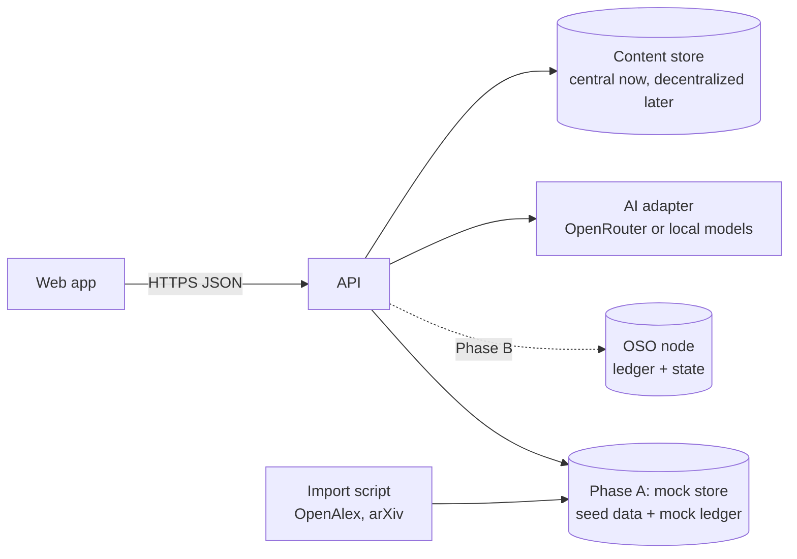

# Architecture and API

Part of the [OSO website and v1 UI design](../ui-v1.md).



- **Web app:** a single-page app (recommendation: TypeScript with React, built with Vite, and a graph library such as Cytoscape.js or a D3 force layout). It can be hosted as static files, for example on GitHub Pages at a subdomain such as app.oso.network.
- **API:** a small service that serves the API contract below. In Phase A it reads seed data from files and computes the simulator with the OIP-14 waterfall. In Phase B it reads from the OSO node instead; the contract stays the same.
- **Import script:** pulls the seed sub-field from OpenAlex and arXiv, builds OIP-16-shaped idea records and citation links, and writes the seed files. AI edge assessments for the curated slice are added in a second step.
- **AI adapter:** one module in the API that calls whichever provider each task is configured for ([AI services and providers](ai.md)), enforces the budget, and records outputs.

**Repository.** A new repository for the app and API (for example `open-science-org/app`), keeping the website in `open-science-org.github.io`. The 2019 `idea-hub` code is a different stack and is best kept as history.

These are recommendations; Abinash and Bikrant should confirm or change the stack in the first week and record the choice here.


## API contract

JSON over HTTPS, read-only except the simulator and chat. Field names follow OIP-16. The contract is versioned (`/v1/...`) so that the front end and back end can be built in parallel against it.

| Endpoint | Returns |
| --- | --- |
| `GET /v1/ideas?q=&type=&year=&page=` | Search results: work ID, title, authors, year, type |
| `GET /v1/ideas/{work_id}` | Idea: current version fields (OIP-16 section 4) plus registry summary (status, claimed or unclaimed, origin date) |
| `GET /v1/ideas/{work_id}/graph?depth=2` | Nodes and edges: each edge with type, weight in bps (if approved), and evidence (citation, AI score and category, approval) |
| `POST /v1/simulate/fund` `{work_id, amount}` | Per-idea amounts received, retained and passed upstream, by level |
| `POST /v1/chat` `{work_id, messages}` | Answer with cited work IDs (streamed) |
| `GET /v1/ledger/blocks?page=` and `/v1/ledger/blocks/{n}` | Mock blocks and transactions |
| `GET /v1/communities` and `/v1/communities/{id}/setup` | Communities, and one community's setup: modules, parameters, interface options, version ([Modular and customizable design](modularity.md)) |
| `GET /v1/graph?view=lineage&types=&min_weight=&years=` | Nodes and edges for a whole-field view ([Graph explorer](app.md#graph-explorer)) |
| `GET /v1/graph/map` and `/v1/graph/path?from=&to=` | Field-map positions and clusters; the path between two ideas |
| `GET /v1/graph/export?format=json` (or `graphml`) | Graph export |
| `GET /v1/ideas/{work_id}/cite?format=bibtex` and `/badge.svg` | Citation and badge |
| `GET /v1/transparency` | Ledger status, fund, bootstrap pool, AI spending ([Profile, notifications, transparency and admin](app.md#profile-notifications-transparency-and-admin)) |
| `/mcp` and `/mcp/ideas/{work_id}` | MCP servers for the whole graph and for one idea ([Agent access: the graph as a filesystem](integrations.md#agent-access-the-graph-as-a-filesystem) and [An MCP endpoint for every idea](integrations.md#an-mcp-endpoint-for-every-idea)) |

Phase B adds sign-in (`/v1/auth/*` for each provider, `POST /v1/me/linked-accounts`, `POST /v1/me/attestations/orcid`) and, behind sign-in: `POST /v1/submissions` (with signatures), `GET /v1/me/submissions`, `GET /v1/me/validation-queue`, `POST /v1/votes`, `GET /v1/me/review-invitations`, `POST /v1/reviews`, `POST /v1/review-ratings`, `POST /v1/challenges`, `POST /v1/appeals`, `GET /v1/me/claim-matches`, `POST /v1/claims`, `GET/PUT /v1/me/notifications` and webhooks. Each maps to a ledger transaction; the API only prepares and relays signed transactions, it does not decide outcomes.

Example idea response (abridged):

```json
{
  "work_id": "sha256:<64 hex characters>",
  "version": {
    "type": "preprint",
    "title": "LoRA: Low-Rank Adaptation of Large Language Models",
    "attribution": [{"name": "Edward J. Hu", "orcid": ""}],
    "external_ids": {"arxiv": "2106.09685"},
    "license": "LicenseRef-see-source",
    "content_refs": [{"role": "main", "uri": "https://arxiv.org/abs/2106.09685", "hash": "", "media_type": "text/html"}]
  },
  "registry": {"status": "imported", "claimed": false, "origin_date": "2021-06-17", "tier": "curated"}
}
```
